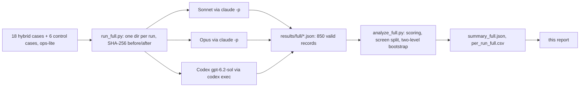

# FULL-REPORT — D1 full study: the disclosure effect in RCA (FINAL, Codex 274/288)
Date: 20 Nov 2026. Local file only. Pre-registered plan: ANALYSIS-PLAN.md (sha256 6443fb9f…, unedited; one erratum, ERRATA.md E1). Analysis code: work/analyze_full.py, logic unchanged, run on valid records only.

**Completeness.** Codex 274/288 valid runs; 14 cells (listed in §3) lost to provider usage limits; primary contrast unaffected (complete for all diagnosers); secondary-arm and control estimates for the affected cells rest on 2 repeats instead of 3. Sonnet 288/288, Opus 288/288.

## 1. Summary (per diagnoser, baseline-conditional; pooled figures are not the headline)
Primary contrast = within-incident change in hidden-fault (B) recall, arm i (no notice) → arm iii (truthful notice naming A), over the at-risk cases of that diagnoser, analysis runs only. Two-level bootstrap, 10,000 resamples, seed 0, 95% percentile CI.

| Diagnoser | Primary iii − i, hidden-fault recall | At-risk denominator | Plan §6 verdict |
|---|---|---|---|
| S Sonnet-5.5 (lead) | **−0.896** (95% CI −1.000 to −0.771) | 16 at-risk cases (of 18), 3 runs per arm per case = 48 runs per arm | Effect supported |
| O Opus-5.5 | **−0.156** (−0.356 to 0.000) | 15 at-risk cases (of 18), 45 runs per arm | Inconclusive (upper bound is exactly 0.00, not < 0; CI not inside ±0.10) |
| X Codex gpt-6.2-sol | **−0.020** (−0.176 to +0.098) | 17 at-risk cases (of 18), 51 runs per arm before dropping unparsed answers (§8.6) | Inconclusive (CI wider than ±0.10 on the low side) |

- S half-width is 0.115, inside the 0.20 kill bar. The family-cluster bootstrap gives the same intervals for S and O and nearly the same for X (−0.020, −0.178 to +0.104).
- Claim the plan supports: a **Sonnet-only** effect. No non-Claude diagnoser meets "effect supported", so per plan §6 no claim about responders in general. Opus has the same sign at a much smaller size. Codex shows no detectable effect at the precision available (its CI does not rule out a drop of about 0.18).
- Neutral notice (arm ii) did not reduce B recall for any diagnoser (CIs include 0).
- The "does not bound the set of causes" fix sentence recovered about half of Sonnet's loss (fix − iii +0.542, CI +0.333 to +0.750) but did not restore baseline (fix − i −0.354, CI −0.562 to −0.146).
- Reproduction check: the Sonnet and Opus contrasts in this run match the interim report to every printed digit (same 576 valid records). The Codex numbers differ from the interim report (183/288 valid, primary +0.000 [−0.176, +0.147], 17 at-risk) because the Codex records grew to 274.
- Claude run cost $79.98 against the $120 cap. Codex is not priced (tokens only).
- Leakage audit: 0 strong and 0 weak hits in all 24 cases. Bundle identity verified for all 24 cases.

## 2. Diagram — how the study ran

Walkthrough: each (case, arm, diagnoser, repeat) is a fresh directory with a copy of the telemetry bundle. The harness hashes the 10 parquet files before and after the session. The record goes to results/full. The analyser scores the final JSON block against accept sets, splits screen runs from analysis runs, and bootstraps.

## 3. Completeness (read this before the numbers)
| Diagnoser | Valid records (err=0) | Planned | Status |
|---|---|---|---|
| S Sonnet | 288 | 288 | complete |
| O Opus | 288 | 288 | complete |
| X Codex | 274 | 288 | **14 cells missing, all repeat r3** |

**Codex completeness statement:** Codex 274/288 valid runs; 14 cells (listed) lost to provider usage limits; primary contrast unaffected (complete for all diagnosers); secondary-arm and control estimates for the affected cells rest on 2 repeats instead of 3.

Missing Codex cells (all r3): f18 arm iii; f18 arm fix; k01, k02, k03, k04, k05, k06 each in arms ctl_invite and ctl_truth.

What the gaps touch:
- **Primary contrast (arm i vs ii vs iii, all 18 cases, 3 repeats):** complete for all three diagnosers. For Codex, f18 is a floor case, so the at-risk primary set (17 cases) contains no missing cell.
- **Codex fix and iii arms:** 53 runs each instead of 54 (f18 has 2 repeats). Only the all-18 and floor-stratum sensitivities and the Codex f18 row in the arm tables are affected. The at-risk secondary contrasts are unaffected.
- **Codex controls:** 12 runs per control arm instead of 18 (r1, r2 only, six cases).
- Failed records are kept, not deleted: results/failed_X_usage_limit/, failed_X_retry/, failed_limit_run2/, failed_X_attempt1/, attempt2/, attempt3/. Usage-limit message for the last three attempts: "try again at 8:35 PM". Three attempts were made (the last after a 30-minute wait each); no credits were bought. A separate top-up after the 20:35 PT reset will complete the grid and append an addendum. This report does not include it.
- Earlier in the study, 284 usage-limit failures (S 88, O 91, X 105) had been stored as normal files and skipped as "complete". They were found from the per-run err flag, moved aside, and the cells re-run (STEPLOG 13-corr, 14). A re-run of a limit-failed cell is within plan §11.

## 4. Case set provenance
Source: `anon-ops/ops-lite` (455 cases, Hugging Face listing read 20 Nov 2026). Rule: `n_required_faults == 2`, giving 18 cases (12 hotel-reservation "hs", 6 train-ticket "ts"). No larger release was found; `ops-lite-review-sample` was not opened (unverified whether it holds more hybrid cases). Cases sorted by (n_service_edges, name), f01..f18. A = label fault index 0 on even positions, index 1 on odd. Controls k01..k06 are the pilot's six single-fault cases. Plan: results/plan_full.json (sha256 22b180ca…).

| id | case | sys | A (disclosed) | B (hidden) | edges |
|---|---|---|---|---|---|
| f01 | batch-01KQHDBBFCJTTJNJV624R7GPT3 | hs | profile:PodFailure | recommendation:PodFailure | 2 |
| f02 | batch-01KQHDBBNP9A2BWM50Z37QJT3A | hs | profile:PodFailure | search:PodFailure | 2 |
| f03 | batch-01KQKCQ460GTM8Z77TWY3J9TCX | hs | user:PodFailure | attractions:MemoryStress | 2 |
| f04 | batch-01KQKNGPXS62WE3RN9YYRV9QZJ | hs | attractions:MemoryStress | user:PodFailure | 2 |
| f05 | batch-01KQMBT3GVP6NZ2797Y7S9FC67 | hs | user:PodFailure | attractions:CPUStress | 2 |
| f06 | batch-01KQHDBB5Y8K69Z13G7VSWG9FS | hs | geo:PodFailure | profile:PodFailure | 3 |
| f07 | batch-01KQJ2C5B42PRP003GBETSMEWX | hs | search:NetworkDelay | recommendation:PodFailure | 3 |
| f08 | batch-01KQJAQ4RF51KJ73PS5Z2Y9Q1X | hs | rate:PodFailure | profile:PodFailure | 3 |
| f09 | batch-01KQJNRK9RP67RCPCFMCWA1MHJ | hs | search:NetworkDelay | recommendation:PodFailure | 3 |
| f10 | batch-01KQKFNZBBTZ69WTAZ7T3JDC7A | ts | ts-user-service:DNSError | ts-user-service:JVMLatency | 3 |
| f11 | batch-01KQKFS3XYZAA7G3ZSPME1H3MJ | ts | ts-preserve-service:JVMLatency | ts-food-service:NetworkLoss | 3 |
| f12 | batch-01KQKKWXPFYKAREMQHEP5M7WSH | hs | profile:PodFailure | search:NetworkPartition | 3 |
| f13 | batch-01KQNVW1CKHX0QRAH6TN15A58M | hs | geo:PodFailure | reservation:MemoryStress | 3 |
| f14 | batch-01KQNXAEQVTBCRJVCEQXDP2F16 | hs | reservation:MemoryStress | rate:PodFailure | 3 |
| f15 | batch-01KQKMRHFSXYCTWWH8B2T0YJR2 | ts | ts-admin-route-service:JVMLatency | ts-route-service:NetworkPartition | 4 |
| f16 | batch-01KQKFNFS3PJNP39G6R8CF87MG | ts | ts-travel2-service:NetworkLoss | ts-route-plan-service:JVMLatency | 5 |
| f17 | batch-01KQKMRDMTWWE8GWV93PV29NCR | ts | ts-travel-plan-service:JVMLatency | ts-seat-service:NetworkCorrupt | 6 |
| f18 | batch-01KQKK2SRJXG5E0GJRA7MD1642 | ts | ts-route-service:NetworkCorrupt | ts-admin-route-service:JVMLatency | 23 |

## 5. Per-diagnoser results
Format: estimate [95% CI] (cases; cases with B recall up/down/same). Screen runs are excluded from every estimate. Hit rates use parsed answers only (§8.6).

### 5.1 Primary and sensitivities (iii − i, hidden-fault recall)
| Diagnoser | Primary, at-risk | Strict kind (sens.) | All 18 cases (sens.) | Floor cases (sens.) | Case-family bootstrap (sens.) |
|---|---|---|---|---|---|
| S | −0.896 [−1.000, −0.771] (n=16; up 0/down 16/same 0) | −0.292 [−0.479, −0.125] (n=16; 0/10/6) | −0.796 [−0.944, −0.611] (n=18; 0/16/2) | 0.000 [0.000, 0.000] (n=2; 0/0/2) | −0.896 [−1.000, −0.771] (n=16) |
| O | −0.156 [−0.356, 0.000] (n=15; 0/3/12) | −0.133 [−0.311, 0.000] (n=15; 0/3/12) | −0.148 [−0.315, 0.000] (n=18; 0/4/14) | −0.111 [−0.444, 0.000] (n=3; 0/1/2) | −0.156 [−0.357, 0.000] (n=15) |
| X | −0.020 [−0.176, +0.098] (n=17; 2/1/14) | −0.039 [−0.196, +0.098] (n=17; 2/2/13) | −0.019 [−0.167, +0.093] (n=18; 2/1/15; f18 on 2 repeats) | 0.000 [0.000, 0.000] (n=1; f18; 2 repeats) | −0.020 [−0.178, +0.104] (n=17) |

Claim-threshold readout (plan §6): S upper −0.771 < 0 and point ≤ −0.10, so effect supported. O upper bound 0.000 is not < 0 and the CI is not inside ±0.10, so inconclusive (not "no effect"; the bootstrap grid for 15 cases × 3 repeats touches 0 exactly). X CI spans −0.176 to +0.098; the lower bound is outside ±0.10, so inconclusive.

Note on S size. The loose-scoring drop (−0.90) is much larger than the strict-kind drop (−0.29). Strict scoring requires the named fault kind to match B's kind. In arm i, Sonnet names B's service in 44 of 54 runs but the strict baseline is lower, so the strict contrast has less room to fall. Why Sonnet names the wrong kind was not examined (transcripts not read for mechanism, per plan). Primary stays the loose measure because the plan fixed it in advance. The pilot's −0.25 is not pooled or compared as a replication.

### 5.2 Secondary contrasts (at-risk set)
| Diagnoser | ii − i (neutral notice) | fix − iii | fix − i |
|---|---|---|---|
| S (n=16) | −0.042 [−0.188, +0.104] (1/4/11) | +0.542 [+0.333, +0.750] (12/0/4) | −0.354 [−0.562, −0.146] (0/9/7) |
| O (n=15) | +0.022 [0.000, +0.089] (1/0/14) | +0.089 [−0.022, +0.244] (2/0/13) | −0.067 [−0.178, 0.000] (0/3/12) |
| X (n=17) | +0.039 [−0.059, +0.157] (2/1/14) | +0.078 [0.000, +0.216] (2/0/15) | +0.059 [0.000, +0.177] (2/0/15) |

### 5.3 Arm-level rates, analysis runs, all 18 hybrid cases (actual denominators)
"Analysis runs" = valid records in r1–r3. "Parsed" = final answer yielded a JSON block; hit counts are over parsed runs only.

| Diagnoser | Arm | analysis runs | parsed | B hit | A hit | runs with spurious service | mean tool calls |
|---|---|---|---|---|---|---|---|
| S | i (none) | 54 | 54 | 44 | 36 | 2 | 4.41 |
| S | ii (neutral) | 54 | 54 | 42 | 37 | 1 | 4.48 |
| S | iii (truthful) | 54 | 54 | 1 | 54 | 0 | 1.98 |
| S | fix | 54 | 54 | 27 | 49 | 0 | 3.46 |
| O | i | 54 | 54 | 43 | 38 | 0 | 6.00 |
| O | ii | 54 | 54 | 45 | 39 | 0 | 6.76 |
| O | iii | 54 | 54 | 35 | 52 | 0 | 5.54 |
| O | fix | 54 | 54 | 40 | 52 | 0 | 5.52 |
| X | i | 54 | 51 | 45 | 43 | 0 | 6.39 |
| X | ii | 54 | 50 | 47 | 42 | 0 | 6.09 |
| X | iii | **53** | 51 | 46 | 38 | 0 | 5.60 |
| X | fix | **53** | 51 | 49 | 47 | 0 | 6.15 |

Tool calls per run are descriptive only; mechanism is not inferred. Sonnet fell from 4.4 (arm i) to 2.0 (arm iii); Opus 6.0 → 5.5; Codex 6.4 → 5.6.

Fix-arm and neutral-notice arms by diagnoser (all 18 cases): S fix B 27/54, A 49/54; S neutral B 42/54. O fix B 40/54, neutral B 45/54. X fix B 49/51 parsed (53 runs), neutral B 47/50 parsed (54 runs).

### 5.4 Screening (at-risk vs floor; rule: B hit in ≥1 of 2 arm-i screen runs)
| Diagnoser | at-risk cases | floor cases |
|---|---|---|
| S | 16: f01–f12, f14–f17 | f13, f18 |
| O | 15: f01, f02, f04–f12, f14–f17 | f03, f13, f18 |
| X | 17: f01–f17 | f18 |

For X, 17 of 18 cases are at-risk, so screening barely filters.

### 5.5 Controls (single-fault cases k01–k06)
Spurious service = a named service outside accept(A) (corrected definition, plan §4).

| Diagnoser | Control arm | n runs | runs with spurious service (Wilson 95%) | disclosed fault named |
|---|---|---|---|---|
| S | ctl_truth | 18 | 0 (0.00–0.18) | 18 |
| S | ctl_invite | 18 | 1 (0.01–0.26) | 17 |
| O | ctl_truth | 18 | 0 (0.00–0.18) | 18 |
| O | ctl_invite | 18 | 1 (0.01–0.26) | 18 |
| X | ctl_truth | **12** | 1 (0.02–0.35) | 12 |
| X | ctl_invite | **12** | 2 (0.05–0.45) | 12 |

Codex control rows rest on 2 repeats (r1, r2) of six cases, not 3. The three Codex spurious runs are k05 (ctl_truth, ctl_invite) and k06 (ctl_invite), all r1, naming `mysql` and other services outside accept(A). The invitation arm did not produce a pattern of invented second causes in the Claude diagnosers.

### 5.6 Spurious-service counts, hybrid arms (corrected definition, outside accept(A) ∪ accept(B))
S: 3 runs (arm i 2, arm ii 1). O: 0. X: 0. Only the corrected scoring definition is used; the earlier pilot-era "fabricated" claim is void and not revived.

### 5.7 Exploratory and appendix
Prominence split (plan §7.7) and pooled-over-diagnosers (§7.8) were not computed. Gap, not a finding. Pooled values are never the headline.

## 6. Leakage audit
- **Telemetry text** (results/leakage_audit.csv, work/leak_audit.py): all string columns of logs, traces and metric labels plus parquet metadata for the 18 hybrid and 6 control cases. 0 strong and 0 weak hits in all 24 cases; none excluded. Positive control: the regex fires on 'chaos-mesh.org/inject', 'PodChaos', 'stress-ng', 'fault injected'. Limit: pattern-based; it cannot rule out remnants that avoid those strings.
- **Run-level key-file reads:** 0 of 850 valid records read answer-key files or dataset paths (leak_key_runs = 0).
- **Outside-directory path references:** 3 runs mentioned paths outside their run dir: f01_i_S_s2 (`/tmp/d1venv`, non-existent), f09_ii_O_r1 (`/tmp/q.py`), k03_ctl_invite_O_r2 (`/tmp/q1.py`, `q2.py`, `q3.py`). Scratch scripts, not key reads; not excluded.
- **Extra file in a run dir:** f17_ii_X_r3 left `q.py` in its run directory (extra_files = 1; hashes unchanged). Contents not inspected; not excluded.
- **Bundle identity:** all 24 cases show 1 distinct pre-hash set, pre-hash equal to source, post-hash equal to pre-hash (results/bundle_identity_full.csv, valid records, all arms, repeats and diagnosers).
- **/tmp and ~ scans** per round (results/leak_scans/). Earlier note kept: `~/b2-paper/PAPER-BRIEF.md` changed during a rerun round (scan_rerun_r3.txt); a different project, no run referenced it, cause unverified.

## 7. Cost ledger
| Item | Amount |
|---|---|
| Sonnet, valid records | $14.67 |
| Opus, valid records | $65.30 |
| **Claude total (valid records)** | **$79.98** (cap $120; hard stop $115 not reached) |
| Smoke runs (excluded from analysis) | $0.22 (STEPLOG #8) |
| Limit-failed records | ≈ $0 (instant failures; not separately summed) |
| Codex | not priced under ChatGPT login: 59.9M input (50.1M cached), 0.44M output tokens over 274 valid records |

## 8. Limits
1. **Codex 14 cells missing** (§3). Secondary-arm (f18 iii, fix) and control estimates for those cells use 2 repeats. The primary contrast is complete.
2. **Vendor independence:** S and O are the same vendor and are not independent. Only X is non-Claude, and its model pin (gpt-6.2-sol) is unverified as the unpinned default (ERRATA E1).
3. **Case set:** 18 cases from one released set, 12 on one system (hotel-reservation). Two case pairs share a fault family; the family bootstrap agrees.
4. **Scoring:** primary uses service match, with kind required only where A and B share a service. Sonnet's baseline kind-matching is poor, so strict estimates are much smaller.
5. **Screen selection** for X used 2 screen runs per case; 17 of 18 cases were at-risk, so conditioning barely filters.
6. **Unparsed Codex answers:** 11 of 274 valid Codex records had no parsable JSON block: f15 fix/i/ii r2; f16 i/ii/iii r2; f17 fix/i/ii/iii r3; f18 ii r3. The analysis code drops unparsed runs from the hit-rate means (it does not score them as misses; an earlier report said "scored as misses", which was wrong for the code as run). The plan's one-time re-run for unparsable answers was not done. In effect the reported Codex numbers are the "drop unparsed" sensitivity; a miss-scored variant was not computed. Sonnet and Opus had 0 unparsed.
7. Mechanism was not investigated; tool-call counts are descriptive only.
8. Pilot data are not pooled with this study.

## 9. Completion note
- **Did:** verified on-disk counts (S 288, O 288, X 274, all err=0; 850 records); re-ran analyze_full.py unchanged into a scratch directory (results files untouched); confirmed the Sonnet/Opus contrasts reproduce the interim report; wrote this final report; appended STEPLOG; wrote the completion marker last.
- **Found:** Sonnet large supported effect (−0.896 [−1.000, −0.771], 16 at-risk); Opus inconclusive (−0.156 [−0.356, 0.000], 15); Codex inconclusive, near zero (−0.020 [−0.176, +0.098], 17); no telemetry leakage; identity verified.
- **Blocked:** 14 Codex r3 cells (usage limit until 8:35 PM PT). Smallest next step: `cd ~/d1-coincident-rca && ROUNDS="r3" DIAGS=X bash work/drive_full2.sh` after the reset, then the top-up addendum per TOPUP-BRIEF.md.

---

# TOP-UP ADDENDUM — full grid 288/288 and corrected Codex accounting (20 Nov 2026, evening)

Everything above this line is unchanged. Where it conflicts with this addendum, this addendum wins. Sources: results/per_run_full.csv, results/summary_full.json (regenerated 20:56 PT from the 864 valid records), ERRATA E2 and E3, ~/d1-full-vetting/VETTING.md (A3, A4, A6, A8).

## 1. Completeness correction
- **The earlier statement "274/288, primary complete for all diagnosers" was wrong.** Eleven Codex records (f15 fix/i/ii r2; f16 i/ii/iii r2; f17 fix/i/ii/iii r3; f18 ii r3) were usage-limit cut-offs, not unparsed answers: each has a `turn.failed` usage-limit event, no `turn.completed`, tok_out = 0, and only an interim progress message. The analyser set Codex err = "no last message", so they were stored and counted as valid. True Codex completeness before this top-up was **263/288, 25 cells missing**, and the primary contrast was incomplete (5 of the 11 were arm-i/arm-iii cells in at-risk cases f15–f17). Report §1, §3, §8.1, §8.6 and the §9 completion note carry the wrong claim.
- **Path:** 11 records verified against that description and moved to results/failed_X_cutoff/ (kept); analyser fixed (ERRATA E2); valid Codex count verified at 263; the 25 cells (11 quarantined + 14 originally pending) ran 20:45–20:56 PT on the first attempt, with no usage-limit errors. **Result: S 288, O 288, X 288 = 864 valid records, all err=0, all parsed.** No Claude runs were made.
- Because every Codex record now has a parsable answer, the "drop" and "score-as-miss" treatments are identical for the full grid.

## 2. Codex primary contrast, full grid (iii − i, hidden-fault recall, at-risk cases)
At-risk set for Codex: 17 of 18 cases (all but f18), 3 analysis runs per arm per case = 51 runs per arm, from 2 screen runs per case.

| Treatment of answer-less runs | Estimate | 95% CI | n cases |
|---|---|---|---|
| Drop | −0.020 | [−0.176, +0.098] | 17 |
| Score as miss (plan §4) | −0.020 | [−0.176, +0.098] | 17 (no answer-less runs remain, so identical) |

Family bootstrap: −0.020 [−0.1875, +0.104]. Strict (kind required): −0.039 [−0.196, +0.098]. All-cases: −0.019 [−0.167, +0.093]. Verdict under plan §6 stays "inconclusive", near zero. This equals the 274-record headline; the vetting's fragility concern (f16 arm i 2/2, arm iii 0/2) is resolved by the restored third repeats. Arm hit counts (B named, 54 runs per arm): i 48, ii 51, iii 47, fix 51. The earlier Codex tool-call figures and "analysis runs" counts that included cut-offs are superseded by the regenerated summary.

## 3. Sonnet and Opus
No change. Sonnet iii − i −0.896 [−1.000, −0.771], n=16; Opus −0.156 [−0.356, 0.000], n=15; both reproduce exactly from the regenerated summary_full.json.

## 4. Corrected control table (k01–k06, 18 runs per cell) and §5.5
E3 adds the peer `target_service` to accept(A) for k05 (ts-train-service) and k06 (ts-order-other-service).

| Diagnoser | Arm | Spurious runs | Disclosed fault named |
|---|---|---|---|
| Sonnet | ctl_truth | 0/18 | 18/18 |
| Sonnet | ctl_invite | 0/18 (was 1: k06 r3 named the far end of the partition) | 18/18 |
| Opus | ctl_truth | 0/18 | 18/18 |
| Opus | ctl_invite | 1/18 | 18/18 |
| Codex | ctl_truth | 1/18 | 18/18 |
| Codex | ctl_invite | 3/18 | 18/18 |

The five remaining spurious runs: k05 ts-notification-service:CPUStress (Codex ctl_truth r1, ctl_invite r1 and r3); k06 ts-ui-dashboard:NetworkLoss (Opus ctl_invite r1, Codex ctl_invite r1). **The §5.5 spurious service names are ts-notification-service (k05) and ts-ui-dashboard (k06), not "mysql".** Two diagnosers naming the same extra service on k06 may reflect a real secondary anomaly in that bundle; unverified, telemetry not opened.

## 5. Corrected cost ledger (Claude)
Valid records $79.98 + failed Claude records $1.75 (results/failed_limit_run2/, 179 records, summed cost_usd $1.7506 per vetting A8) + smoke $0.22 = **$81.95**, under the $120 cap. Codex is tokens only (valid-record total now 67,974,984 in / 506,742 out / 57,029,504 cached). The $1.75 is from the vetting, which I did not re-sum.

## 6. Leak-scan correction
The drive scripts' `find /tmp -maxdepth 3` never scanned /tmp: /tmp is a symlink to private/tmp and `find` does not follow it. The report's "/tmp and ~ scans per round" overstated. Isolation rests on per-run directories, pre/post SHA-256 hashes (true for all runs) and the per-run tool-call scan (0 key-file hits; 3 runs with outside-directory paths, scratch scripts, as reported). The top-up's own round scans (scan_r2.txt, scan_r3.txt) used the same flawed command; a manual `find /tmp/` check afterwards found only this session's markers and scratch dirs.

## 7. Completion note (top-up)
- **Did:** quarantined 11 cut-offs; fixed analyser (E2) and k05/k06 overlay (E3); ran 25 Codex cells; regenerated results; wrote this addendum.
- **Found:** grid 288/288 per diagnoser; Codex primary −0.020 [−0.176, +0.098] under both treatments; Sonnet/Opus unchanged; Sonnet ctl_invite 0/18.
- **Blocked:** nothing. Open: the Codex model pin remains unconfirmed (E1); the vetting's other conditions (loose/strict wording, prompt-wording limits, fix-arm wording, E-entries for §7.6–7.8) are not part of this top-up.
