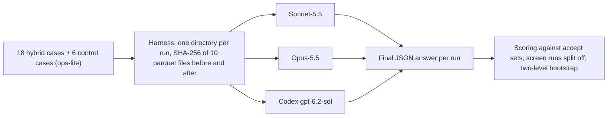

# The Disclosure Effect in LLM Root Cause Analysis: A Truthful Notice About One Injected Fault Suppresses Diagnosis of a Hidden Second Fault

**Sajish Krishnan**
Independent researcher
ORCID: 0009-0009-7561-9290
*21 November 2026*

## Abstract

When an operations team runs a planned fault-injection experiment, responders may be told which fault was injected. We ask whether that truthful notice changes whether an LLM responder doing root cause analysis finds a second, independent cause that was not disclosed. We replay the same incident under four notice conditions (no notice, neutral notice, truthful notice naming one fault, and the truthful notice plus one sentence saying the notice does not bound the set of causes). We use the 18 two-fault ("hybrid") cases of the public OpenRCA 2.0 ops-lite release and three diagnosers: Sonnet-5.5, Opus-5.5 and a Codex model (gpt-6.2-sol). The analysis plan, including the primary contrast and the claim thresholds, was fixed before the runs. The primary contrast is the within-incident change in hidden-fault recall from no notice to truthful notice, over the cases where that diagnoser found the hidden fault without a notice.

For Sonnet-5.5 the change is −0.896 (95% CI −1.000 to −0.771; 16 at-risk cases, all 16 fall). That is a drop in how often it names the hidden fault's service. Under the stricter rule that also requires the fault kind to match, the change is −0.292 (−0.479 to −0.125). For Opus-5.5 the change is −0.156 (−0.356 to 0.000, 15 cases), which is inconclusive under the plan. For the Codex model it is −0.020 (−0.176 to +0.098, 17 cases), also inconclusive. The Codex grid is complete: 288 of 288 planned runs are valid, after 25 cells whose first attempts were lost to provider usage limits were re-run, and the estimate is the same as the partial grid gave. A neutral notice did not reduce hidden-fault recall for any diagnoser. The extra fix sentence recovered part of Sonnet's loss, case by case, and did not restore baseline. We claim a Sonnet-only effect, for one prompt and one notice wording. We make no claim about responders in general.

## 1 Introduction

Planned fault injection is routine in reliability engineering. During such an exercise, the people or agents who respond to alerts are sometimes told what was injected. The notice is true, and it is useful: it explains an anomaly that would otherwise be a mystery. The question here is whether it also has a cost. A responder given a correct explanation for one anomaly may stop looking for others.

This question matters because incidents do not respect experiment boundaries. An injection can coincide with an unrelated fault. If a notice leads a responder to stop at the disclosed cause, the undisclosed cause is more likely to go unfound. We call this kind of effect anchoring, as a label and without citing a literature for it. We do not test humans. We test LLM diagnosers that are being proposed for the responder role, and we measure the effect directly rather than assuming it.

We use a paired replay. Each incident is a fixed telemetry bundle with two known injected faults. We designate one fault as disclosed (A) and the other as hidden (B). The diagnoser sees the same bundle under different notice wording, so the incident is held fixed and only the notice varies. The primary measure is hidden-fault recall: does the diagnoser name B?

What we report:

1. For Sonnet-5.5, a large drop in hidden-fault recall under a truthful notice (−0.896 loose, −0.292 strict), with every one of 16 at-risk incidents moving down.
2. For Opus-5.5, a smaller drop in the same direction that the plan classes as inconclusive. For the Codex model, a near-zero estimate whose interval does not exclude a drop of about 0.18, from a complete grid.
3. No drop under a neutral notice for any diagnoser.
4. A one-sentence mitigation that recovers part of Sonnet's loss on some incidents and none on others.
5. A list of what limits the claim: one benchmark, 18 incidents, one prompt, one notice wording, and scoring choices that move the Sonnet estimate between −0.29 and −0.90.

The pre-registered plan allowed us to report a null, a Sonnet-only result, or a pilot-extension label. The result is Sonnet-only.

## 2 Related Work

**Premature commitment in RCA agents.** OpenRCA 2.0 (arXiv:2606.27154) is a benchmark with causal-process supervision. In its failure-mode analysis, error pattern (1) is "Premature commitment under under-exploration": after identifying one plausible root cause, the agent stops investigating and leaves co-occurring faults unexamined. The paper reports that on hybrid injections that pair one prominent fault with one subtle one, every evaluated model converges on the prominent half and uniformly misses the subtle half. That finding concerns which fault is salient. Our design differs in what varies. We hold the incident fixed and vary only whether a truthful notice names one of the two faults. OpenRCA 2.0 also lists information availability (restricted telemetry) as a controllable evaluation axis that it leaves to future work. We vary a different quantity, the notice, and do not restrict telemetry. In the pilot that preceded this study, the effect came from rotated cases where the hidden fault was as loud as the disclosed one, so we assign A and B by a fixed alternation rule and not by prominence (§3.1).

**RCA benchmarks.** OpenRCA 2.0 compares itself with five earlier benchmarks: OpenRCA 1.0 (Xu et al., ICLR 2025), AIOpsLab (Chen et al., MLSys 2025), RCAEval (Pham et al., Companion Proceedings of the ACM Web Conference 2025, pp. 777–780), Stratus (Chen et al., 2025) and Fang et al. (2025). RCAEval is a benchmark of root-cause analysis for microservice systems with telemetry data. These benchmarks score a diagnoser's answer against labelled faults. The OpenRCA 2.0 comparison table does not list a notice-variation axis for any of them, and we know of no benchmark among these that holds the incident fixed and varies a truthful notice (we did not survey beyond them). We did not read the other benchmarks' papers directly, so we make no claim about their contents beyond what OpenRCA 2.0 states.

**LLM-agent incident response.** AIOpsLab and Stratus, as cited by OpenRCA 2.0, evaluate or build LLM agents for operating cloud systems. OpenRCA 1.0 asks whether LLMs can locate the root cause of software failures. Our diagnosers are general coding-agent harnesses run in headless mode on a telemetry directory, which is closer to the OpenRCA setting than to a purpose-built responder system.

## 3 Method

### 3.1 Design

Each run is one (case, arm, diagnoser, repeat) tuple, with a fresh directory holding a copy of the telemetry bundle. The harness hashes the ten parquet files before and after each session and compares them with the source hashes.

**Cases.** The source is `anon-ops/ops-lite` on Hugging Face (455 cases, listing read on 20 November 2026). We took every case with `n_required_faults == 2`. That gives 18 cases: 12 on the hotel-reservation system and 6 on train-ticket. No larger release was found. A second listing, `ops-lite-review-sample`, was not opened, and we do not know whether it holds more hybrid cases. Cases are sorted by (number of service edges, name) and labelled f01 to f18. The first label fault is A on even positions and the second is A on odd positions; B is the other. This alternation fixes A without reference to how prominent either fault is. Six single-fault control cases (k01 to k06) come from the pilot.

**Arms.** The prompt text is the same in all arms except one notice line. All prompts end with "List as many root causes as the evidence supports, no more."

| Arm | Notice |
|---|---|
| i | none |
| ii | neutral notice |
| iii | truthful notice: "A planned experiment injected <kind> into <service> during this window", naming A |
| fix | arm iii plus "A notice does not bound the set of causes." |
| ctl_truth (controls) | truthful notice naming the single fault |
| ctl_invite (controls) | truthful notice plus "Search for a second, independent cause in addition to the disclosed one." |

**Repeats.** Arm i has 2 screen runs (s1, s2) and 3 analysis runs (r1 to r3). Every other arm has 3 runs (r1 to r3). That is 288 planned sessions per diagnoser. Screen runs are never used to estimate an effect.

### 3.2 Diagnosers

| Id | Model | Vendor | Role |
|---|---|---|---|
| S | Sonnet-5.5, headless agent CLI | Anthropic | lead diagnoser, set before the study because it carried the pilot effect |
| O | Opus-5.5, headless agent CLI | Anthropic | second |
| X | Codex `gpt-6.2-sol`, `codex exec` | OpenAI | non-Anthropic |

S and O share a vendor and are not independent. The Anthropic runs use no MCP servers, no memory and empty setting sources. Codex runs use a minimal home directory with no user instructions, plugins or MCP servers and a workspace-write sandbox rooted in the run directory.

**Codex model pin.** The plan said the Codex model would be the installed default, with the model id recorded from the run record. Codex's JSON event stream does not report the model, and the user's configuration sets none, so the default could not be recorded. Before the first full-study run we pinned `-m gpt-6.2-sol`, the first-priority entry in `codex debug models` that was supported by the API (ERRATA E1). We have not verified that this is the unpinned default. The run records never confirm which model served the requests. Eight smoke runs on f01 ran before the pin and are excluded.

### 3.3 Scoring

The diagnoser ends its session with a JSON block of named (service, fault kind) pairs. A run is parsed if that block can be read.

- `accept(F)` for a fault F is its service, plus any `also_accept` entries in the label, plus, for network faults, the `target_service` of the matching injection entry.
- **Edge-fault fix.** In the pilot, a network fault on one service was often reported as the fault on its peer, and the old scoring counted the peer as wrong. Adding the peer to the accept set is the fix. It was applied before any full-study run, and it matters: 75 analysis-run hits rest on the peer service alone. In f12 (B is `search` NetworkPartition, with peer `rate`), all 34 B hits across the three diagnosers name `rate` and none name `search`.
- **Hidden-fault hit (primary, "loose").** At least one named service is in accept(B). If accept(A) and accept(B) overlap (this happens in f10 only), the fault kind must also equal B's kind.
- **Strict variant.** The named fault kind must match B's kind in every case.
- **Disclosed-fault hit.** Scored the same way against accept(A).
- **Spurious service.** A named service outside accept(A) ∪ accept(B), or outside accept(A) for controls. A named peer service inside an accept set is not spurious.

The plan said an unparsable final answer would be re-run once and, if still unparsable, scored as a miss, with a sensitivity analysis that drops it. The analysis code as run drops unparsed answers from hit-rate means and does not score them as misses, and the re-run was not done. We report both treatments for Codex (§4.1).

### 3.4 Primary analysis and screening

**At-risk set.** For each (case, diagnoser), the case is *at-risk* if the diagnoser names B in at least one of its two arm-i screen runs. Otherwise the case is *floor*. A diagnoser that never finds B without a notice has nothing to lose from a notice, and including such cases would dilute the contrast toward zero. Screen runs are excluded from every estimate, so selection does not use the data the contrast is computed on.

**Primary contrast, per diagnoser.** For each at-risk case, the mean hidden-fault hit rate over its arm-iii analysis runs minus the mean over its arm-i analysis runs. The statistic is the mean of those per-case differences. The interval is a two-level bootstrap with 10,000 resamples and seed 0. Level 1 resamples at-risk cases with replacement. Level 2 resamples the repeats within each arm of each drawn case. We report the 95% percentile interval.

**Claim thresholds (per diagnoser, fixed in advance).** *Effect supported*: the upper bound is below 0 and the point estimate is at most −0.10. *Null supported*: the whole interval lies inside (−0.10, +0.10). Otherwise *inconclusive*. A claim about responders in general requires a non-Anthropic diagnoser to meet "effect supported". If it does not, the claim is limited to the diagnosers that do. If the lead diagnoser's primary interval has a half-width above 0.20, the study is reported as a pilot extension.

**Sensitivities (labelled as such).** Strict kind scoring; all 18 cases without screening; the floor stratum alone; a case-family cluster bootstrap (family = unordered pair of service:kind; 16 families among the 18 cases).

**Secondary contrasts.** Neutral notice against none (ii − i), fix against truthful notice (fix − iii), fix against none (fix − i), all within the at-risk set. The plan gives these descriptive intervals from the same bootstrap, and we treat them as descriptive.

### 3.5 Pre-registration

`ANALYSIS-PLAN.md` was written before any full-study diagnoser run. Its SHA-256 (starting `6443fb9f`) was recorded in the study log, and the case-set file (`plan_full.json`, SHA-256 starting `22b180ca`) was hashed before the plan. File modification times are consistent with this order (case set 05:15:20, plan 05:15:52, first full-study run 05:22:42 on 20 November). Those times are the only evidence for the order, and the plan was not registered with an external registry. We found no external registry entry. One erratum was filed before the first run (the Codex pin). Three things were not recorded as errata and should be read as deviations or gaps:

- The unparsed-answer handling differs from §4 of the plan, as described above.
- The Codex grid was short of the three repeats the plan requires per cell until the missing cells were re-run (§4.1).
- Two planned secondary analyses were not computed or not reported (prominence split, pooled-over-diagnosers appendix), and the planned rate of a named second cause in controls was dropped from the first report (it is given in §4.5).

The analysis script was last edited 14 seconds after the first r1 run started, with all screen outcomes visible. The study log says the edit fixed a leak-detection pattern and left the logic unchanged. No copy of the earlier version exists, so "logic unchanged" cannot be checked. In the first analysis, an independent rescoring of all 839 parsed runs from the stored named services and the hashed accept sets found 0 mismatches.

### 3.6 Leakage and isolation

Before the plan was written, we scanned every string column of the logs, traces and metric names and services (plus parquet metadata) of all 24 cases for injection-tool and fault-injection strings. There were 0 strong and 0 weak hits. The scan is pattern-based and cannot rule out remnants that avoid those patterns. Each run's tool calls were scanned for reads of answer-key files and dataset paths: 0 of 864 records with an answer. Bundle hashes are unchanged before and after in all runs checked. The per-round scan of the temporary and home directories did not work as written: it ran `find /tmp`, and on this machine `/tmp` is a symbolic link that `find` does not follow without a trailing slash, so it never scanned that directory. Isolation therefore rests on per-run directories, the hash check and the tool-call scan, which found no read of another run's directory or of key files.

## 4 Results

Everything below is reported per diagnoser. Pooled figures over diagnosers were planned as an appendix only and were not computed. Screen runs are excluded throughout.

### 4.1 Completeness

| Diagnoser | Valid runs | Planned | Note |
|---|---|---|---|
| Sonnet-5.5 | 288 | 288 | complete |
| Opus-5.5 | 288 | 288 | complete |
| Codex gpt-6.2-sol | 288 | 288 | complete after re-running 25 cells (see below) |

For Codex, 25 cells were missing from the first analysis. Fourteen had failed at start (f18 arms iii and fix, repeat 3; k01 to k06 in both control arms, repeat 3) and 11 were cut off mid-run after the limit hit (f15 arms fix, i, ii (r2); f16 arms i, ii, iii (r2); f17 arms fix, i, ii, iii (r3); f18 arm ii (r3)). Each cut-off run has a usage-limit error and no completed turn, and its last message is an interim progress line; the analysis script at first scored them as valid but unparsed, because it treated any last message as an answer. We treat them as failures. All 25 cells were re-run after the limit reset and completed, the analysis script's error rule was corrected, and the results below are regenerated from the full grid. All 576 Anthropic-model records end in a successful result.

**The Codex primary contrast is complete in the results reported here.** Five of the cut-off runs were arm-i or arm-iii cells in at-risk cases (f15 arm i (r2), f16 arms i and iii (r2), f17 arms i and iii (r3)), so the first analysis's Codex estimate rested on fewer runs in f15 to f17 than the design intends. On the completed grid the estimate is unchanged (−0.020), and because no answer-less runs remain, the plan's two treatments of missing answers give identical results (§4.2).

### 4.2 Primary contrast

| Diagnoser | iii − i, hidden-fault recall (95% CI) | At-risk cases | Cases down / same / up | Plan §6 verdict |
|---|---|---|---|---|
| Sonnet-5.5 | **−0.896** (−1.000, −0.771) | 16 of 18 | 16 / 0 / 0 | effect supported |
| Opus-5.5 | **−0.156** (−0.356, 0.000) | 15 of 18 | 3 / 12 / 0 | inconclusive |
| Codex gpt-6.2-sol | **−0.020** (−0.176, +0.098) | 17 of 18 | 1 / 14 / 2 | inconclusive |

The Sonnet interval has half-width 0.115, inside the 0.20 bar. Sonnet at-risk cases are f01 to f12 and f14 to f17; Opus at-risk cases are f01, f02, f04 to f12 and f14 to f17; Codex at-risk cases are f01 to f17. For Codex, 17 of 18 cases are at-risk, so screening barely filters. Opus's upper bound is exactly 0.000 and not below 0, so it falls short of "effect supported". It also is not inside ±0.10, so the verdict is "inconclusive" and not "no effect". Codex's lower bound is outside ±0.10, so it is also inconclusive. The family-cluster bootstrap gives the same intervals for Sonnet and Opus and −0.020 (−0.188, +0.104) for Codex.

**The Sonnet effect is a service-level effect.** Loose scoring counts a hit when Sonnet names B's service with any fault kind. Under arm i Sonnet names B's service in 44 of 54 runs but names the right kind in only 14 of 54. Under arm iii the figures are 1 of 54 (loose) and 0 of 54 (strict). The strict contrast is −0.292 (−0.479, −0.125; 10 cases down, 6 unchanged). Both figures belong in any statement of the result: Sonnet stops naming the hidden fault's service, which is a much larger effect than stopping naming its kind, because its baseline kind-matching is poor. Why Sonnet names the wrong kind was not examined. The one arm-iii loose hit (f12) is via the peer service `rate`. A post-hoc variant, not in the plan, treats PodKill and ContainerKill as matches for a true PodFailure and gives an arm-i rate of 26/54 and a contrast of −0.542 (−0.750, −0.3125). The direction does not change under any variant we tried.

**Sensitivities.**

| Diagnoser | Strict kind | All 18 cases | Floor cases |
|---|---|---|---|
| Sonnet-5.5 | −0.292 (−0.479, −0.125), n=16 | −0.796 (−0.944, −0.611), n=18 | 0.000 (0.000, 0.000), n=2 |
| Opus-5.5 | −0.133 (−0.311, 0.000), n=15 | −0.148 (−0.315, 0.000), n=18 | −0.111 (−0.444, 0.000), n=3 |
| Codex gpt-6.2-sol | −0.039 (−0.196, +0.098), n=17 | −0.019 (−0.167, +0.093), n=18 | 0.000 (0.000, 0.000), n=1 |

**Codex under alternative treatments of missing answers.** On the completed grid no run lacks an answer, so the two treatments coincide. The table gives the alternatives, including the interim analysis for comparison.

| Variant | Codex primary (95% CI) |
|---|---|
| As reported: drop runs without an answer | −0.020 (−0.176, +0.098), n=17 |
| Score runs without an answer as misses (plan §4, literal) | −0.020 (−0.176, +0.098), n=17 |
| Drop f15 to f17 (the cases whose cells were completed last) | +0.048 (0.000, +0.119), n=14 |
| Interim analysis, 183 valid records | 0.000 (−0.176, +0.147) |

All four are inconclusive under the plan. On the completed grid the negative estimate comes mainly from a single case: in f16, arm i hits in 3 of 3 and arm iii in 0 of 3. Two cases go the other way (f03, 1/3 to 2/3; f13, 2/3 to 3/3), and the other 14 at-risk cases do not change. The cells that were missing in the first analysis were not random: they fell on the last cases in job order (f15 to f18, the train-ticket cases with the most service edges) and on the late repeats, which is why completing them mattered; on the completed grid f15 and f17 show no difference (3 of 3 in both arms). We reproduced the point estimates in the first three rows from the per-run table. The confidence interval for the third row comes from an independent recomputation, not from our own bootstrap run. Codex's result should be read as "not distinguishable from zero with this grid", and it does not support a null.

### 4.3 Neutral notice and fix arm

| Diagnoser | ii − i (neutral notice) | fix − iii | fix − i |
|---|---|---|---|
| Sonnet-5.5 (n=16) | −0.042 (−0.188, +0.104) | +0.542 (+0.333, +0.750) | −0.354 (−0.562, −0.146) |
| Opus-5.5 (n=15) | +0.022 (0.000, +0.089) | +0.089 (−0.022, +0.244) | −0.067 (−0.178, 0.000) |
| Codex gpt-6.2-sol (n=17) | +0.039 (−0.059, +0.157) | +0.078 (0.000, +0.216) | +0.059 (0.000, +0.177) |

A neutral notice did not reduce hidden-fault recall for any diagnoser. All three intervals include 0.

**The fix arm is a descriptive, one-wording result.** The sentence "A notice does not bound the set of causes" recovered part of Sonnet's loss: hidden-fault recall rose from 1/54 (arm iii) to 27/54, against 44/54 with no notice. In loose terms that is (27 − 1)/(44 − 1) = 60% of the loss. The recovery is by case, not partial everywhere. Among the 16 at-risk cases, seven reach their no-notice level, and f01, f06, f11 and f16 stay at 0 of 3. Twelve cases go up against arm iii and four do not. Fix − i (−0.354) shows that baseline was not restored under loose scoring. Under strict scoring, fix is 12/54 against 14/54 for arm i. The sentence has a price: Sonnet's disclosed-fault recall falls from 54/54 (arm iii) to 49/54 (fix). For Opus and Codex the fix intervals are consistent with a small recovery and with none. Only one fix wording was tested.

### 4.4 Arm-level rates, effort and tool calls

All 18 hybrid cases, analysis runs. "Parsed" is the number of runs whose final answer yielded a JSON block. Hit counts are over parsed runs. The Codex rows are from the completed grid; the first report's Codex rows included the 11 cut-off runs in the run counts and the tool-call means.

| Diagnoser | Arm | Runs | Parsed | B hit | A hit | Runs with spurious service | Mean tool calls |
|---|---|---|---|---|---|---|---|
| Sonnet-5.5 | i | 54 | 54 | 44 | 36 | 2 | 4.41 |
| Sonnet-5.5 | ii | 54 | 54 | 42 | 37 | 1 | 4.48 |
| Sonnet-5.5 | iii | 54 | 54 | 1 | 54 | 0 | 1.98 |
| Sonnet-5.5 | fix | 54 | 54 | 27 | 49 | 0 | 3.46 |
| Opus-5.5 | i | 54 | 54 | 43 | 38 | 0 | 6.00 |
| Opus-5.5 | ii | 54 | 54 | 45 | 39 | 0 | 6.76 |
| Opus-5.5 | iii | 54 | 54 | 35 | 52 | 0 | 5.54 |
| Opus-5.5 | fix | 54 | 54 | 40 | 52 | 0 | 5.52 |
| Codex | i | 54 | 54 | 48 | 45 | 0 | 6.57 |
| Codex | ii | 54 | 54 | 51 | 44 | 0 | 6.37 |
| Codex | iii | 54 | 54 | 47 | 41 | 0 | 5.69 |
| Codex | fix | 54 | 54 | 51 | 50 | 0 | 6.28 |

Under a truthful notice Sonnet's mean tool calls fall from 4.41 (arm i) to 1.98 (arm iii), a drop of more than half. Opus's fall from 6.00 to 5.54, and Codex's from 6.57 to 5.69. In arm iii Sonnet averages 1.98 tool calls and names 1.02 causes per answer: it confirms the named fault and stops. Fix restores Sonnet's tool calls to 3.46. These are descriptive counts. We did not read transcripts for mechanism, and we do not infer one. Per-diagnoser effort settings (reasoning effort or token budgets) were not recorded. Spurious services in the hybrid arms occurred in 3 Sonnet runs (arm i: 2, arm ii: 1) and none for Opus or Codex.

### 4.5 Controls

On six single-fault control cases, the invitation to look for a second cause did not produce a pattern of invented second causes in the Anthropic diagnosers. Counts use the corrected scoring of the controls (see below).

| Diagnoser | Arm | Runs | Runs with spurious service (Wilson 95%) | Disclosed fault named |
|---|---|---|---|---|
| Sonnet-5.5 | ctl_truth | 18 | 0 (0.00–0.18) | 18 |
| Sonnet-5.5 | ctl_invite | 18 | 0 (0.00–0.18) | 18 |
| Opus-5.5 | ctl_truth | 18 | 0 (0.00–0.18) | 18 |
| Opus-5.5 | ctl_invite | 18 | 1 (0.01–0.26) | 18 |
| Codex | ctl_truth | 18 | 1 (0.01–0.26) | 18 |
| Codex | ctl_invite | 18 | 3 (0.06–0.39) | 18 |

**Correction to the control accept sets.** The edge-fault fix was not applied to k05 and k06, whose injection files lack the field the fix reads. In the first analysis, one Sonnet run (k06, ctl_invite, r3) named the far end of the disclosed network partition with the correct kind and was scored as spurious and as missing the disclosed fault. Corrected, Sonnet ctl_invite is 0 of 18 spurious with 18 of 18 disclosed fault named (first analysis: 1 and 17). The Wilson interval for 0 of 18 is the same as for ctl_truth (0.00–0.18). We changed this row from the 1/18 and 17/18 that the first analysis printed. The corrected row comes from an independent review of the case files; the accept-set correction was later written into the analysis script as an overlay, and the regenerated analysis reproduces it. The other five spurious control runs are outside the edge and stand. They are `ts-notification-service` (k05: Codex ctl_truth r1, ctl_invite r1 and r3) and `ts-ui-dashboard` (k06, ctl_invite, Opus r1 and Codex r1). Two diagnosers naming the same extra service on k06 may reflect a real secondary anomaly in that bundle. We did not check the telemetry.

**Rate of a named second cause** (runs naming at least two causes, in the planned secondary analysis): Sonnet ctl_truth 1/18, ctl_invite 3/18; Opus 0/18 and 2/18; Codex 1/18 and 6/18. Three of Codex's four spurious control runs are repeat 1 and one is repeat 3. We do not draw an inference from four runs.

### 4.6 Leakage and cost

Leakage results are in §3.6. Three runs referred to paths outside their run directory (scratch scripts in the temporary directory and one non-existent path), and one run left a scratch file in its own directory. None was a key read, and none was excluded. Actual spend on the Anthropic diagnosers was $81.95: $79.98 for valid records, $1.75 for records that failed on the account limit, and $0.22 for smoke runs, against a $120 cap. Codex runs were metered in tokens only (68.0M input tokens of which 57.0M cached, 0.51M output) over the 288 valid records.

## 5 Discussion

**What the data support.** Under this prompt and this notice wording, Sonnet-5.5 treats a truthful notice as the answer. When the notice names one fault, Sonnet confirms it, makes fewer tool calls and names the hidden fault's service in 1 of 54 runs, against 44 of 54 without a notice. All 16 at-risk incidents move the same way. The effect does not come from the existence of a notice, because a neutral notice does not reduce recall. It comes from a notice that names a specific cause.

**What they do not support.** The data do not support a statement about LLM responders in general. The plan's rule for that statement requires a non-Anthropic diagnoser to meet "effect supported", and Codex does not. Opus-5.5 has the same sign as Sonnet at roughly a sixth of the size, and its interval touches zero. Codex's estimate is near zero on a complete grid, and it does not change under the alternative treatment of missing answers. We cannot tell whether Codex is robust to the notice or whether this design lacks the power to detect an effect of a few tenths. Its interval is consistent with no effect and with a drop of about 0.18.

**Why the headline needs two numbers.** The loose figure (−0.896) answers "does the responder still name the hidden fault's service?". The strict figure (−0.292) answers "does it still name the hidden fault's service with the right kind?". Sonnet's baseline is high on the first and low on the second, so the strict contrast has less room to fall. For an operator, losing the service is the more serious loss, since it removes the lead altogether. The size of the effect in fault-kind terms is smaller.

**Mitigation.** One added sentence recovers about 60% of Sonnet's loose loss in aggregate, but it does so by case. In four incidents it recovers nothing, and it lowers recall of the disclosed fault from 54/54 to 49/54. We tested one wording. We cannot say whether a different wording, or a structural change (for example a required second-cause check), would do better.

**Relation to premature commitment.** OpenRCA 2.0 reports commitment after one prominent fault. Our result is compatible with a related mechanism in which a disclosed cause plays the role of the prominent fault. We did not test mechanism, so we do not claim it. The drop in tool calls is consistent with early stopping and does not show it.

## 6 Limitations

1. **One benchmark, 18 incidents.** All cases come from one released set (ops-lite), 12 of them from one system (hotel-reservation). Two case pairs share a fault family. The family-cluster bootstrap agrees with the main one. We did not open the review-sample release, and we cannot say whether it holds more hybrid cases.
2. **Operational definition of "hybrid".** We call a case hybrid when it has `n_required_faults == 2`. This is a dataset field, not our own judgment that the faults are independent in cause, and we did not verify independence from the telemetry.
3. **Codex grid completion.** The Codex grid was completed by re-running 25 cells — 11 usage-limit cut-offs that the first analysis had counted as valid and 14 that had never run — after the provider limit reset, and the analysis was regenerated (§4.1, §4.2). The estimate did not move, and no runs are missing. The Codex model pin is an unverified assumption about the default (§3.2).
4. **Same vendor.** Sonnet-5.5 and Opus-5.5 are not independent. Codex is the only non-Anthropic diagnoser.
5. **One prompt and one notice wording.** Every arm's prompt ends with "List as many root causes as the evidence supports, no more." The notice reads "A planned experiment injected <kind> into <service> during this window." A claim about disclosure in general would need a second notice wording and a prompt without the parsimony instruction. The result may be specific to this pair. Diagnoser effort settings are not recorded.
6. **Scoring.** The primary measure is service-level for Sonnet (§4.2). The loose and strict estimates differ by a factor of three, and the post-hoc variant sits between them. The pilot's edge-fault artefact is corrected by the peer-service fix, and 75 analysis-run hits depend on that fix. The fix was not applied to the two control cases k05 and k06 in the first analysis (§4.5).
7. **Screening is noisy.** Two screen runs classify a case. Opus f16 is at-risk on one of two screens and then hits in 0 of 3 arm-i runs; Opus f03 is floor on screens and then hits in 1 of 3. Because the selection uses separate runs this adds noise, not bias, and the all-18 sensitivity is reported alongside. For Codex the screen barely filters.
8. **Unparsed and cut-off Codex runs.** Plan §4 says to re-run an unparsable answer once and then score it as a miss. The code instead dropped runs without an answer, and 11 usage-limit cut-offs were at first counted as valid (§4.1, §4.2). All affected cells were re-run to completion, so the reported grid contains no dropped or answer-less runs; the deviation is recorded because the first analysis did not follow the plan.
9. **Plan adherence.** The plan order is evidenced by file times only. The analysis script was edited after the screen outcomes were visible, and the earlier version was not kept (§3.5). The errata file is incomplete (§3.5).
10. **Leak scanning.** The directory-level scan of the temporary directory was blind (§3.6). The home-directory scan was shallow and skipped the places the two command-line tools write. The telemetry scan covers string columns and metric names and services, but not other metric label columns. It is pattern-based. A change to a file belonging to a different project on the same machine appeared during one round (no run referenced it; cause unverified).
11. **Reproducibility of the stored summary.** The stored `summary_full.json` and per-run table were regenerated from the completed grid (864 rows, all valid) by the corrected analysis script, whose hash is recorded in the study's errata. The version stored before the correction counted 11 cut-off Codex runs as valid and has been replaced. The figures in this paper were reproduced from the regenerated per-run table by an independent script at the level of point estimates and counts.
12. **Mechanism.** Tool-call counts are descriptive. Transcripts were not read for mechanism.
13. **Pilot.** The pilot's estimate (−0.25) is not pooled with this study or presented as a replication.

## 7 Conclusion

For Sonnet-5.5, a truthful notice that names one fault in a two-fault incident strongly reduces how often the hidden fault's service is named (−0.896, 95% CI −1.000 to −0.771, 16 at-risk cases), and the same incidents without a notice or with a neutral notice do not show the drop. Measured by service and fault kind together, the drop is −0.292. Opus-5.5 moves in the same direction by −0.156, inconclusively, and the Codex model shows −0.020, inconclusively, on a complete grid. The finding is therefore specific to one diagnoser, one prompt and one notice wording. A one-sentence mitigation recovers part of the loss on most incidents and none on four. The next steps follow from the limitations: test a second notice wording and a prompt without the parsimony instruction, and add cases from a second benchmark.

## Artefact availability

The study harness, the pre-registered analysis plan and its errata, the full study report, and the regenerated per-run table (864 runs) and summary are available at https://github.com/Sajish85/disclosure-effect-llm-root-cause-analysis (Apache-2.0). The incident cases are from the public `anon-ops/ops-lite` dataset (Apache-2.0), cited below.

## References

Only works that the study's own files reference. Bibliographic details for items 2 to 4 are as given in the OpenRCA 2.0 reference list.

1. OpenRCA 2.0: From Outcome Labels to Causal Process Supervision. arXiv:2606.27154. §3.3 (failure-mode characterization), §4 (related work), §5 (assumptions and threats to validity), Table 3 (benchmark comparison).
2. L. Pham, H. Zhang, H. Ha, F. Salim, X. Zhang (2025). RCAEval: a benchmark for root cause analysis of microservice systems with telemetry data. Companion Proceedings of the ACM Web Conference 2025, pp. 777–780.
3. J. Xu, Q. Zhang, Z. Zhong, S. He, C. Zhang, Q. Lin, D. Pei, P. He, D. Zhang, Q. Zhang (2025). OpenRCA: can large language models locate the root cause of software failures? ICLR 2025.
4. Y. Chen, M. Shetty, G. Somashekar, M. Ma, Y. Simmhan, J. Mace, C. Bansal, R. Wang, S. Rajmohan (2025). AIOpsLab: a holistic framework to evaluate AI agents for enabling autonomous clouds. MLSys 2025.
5. Y. Chen, J. Pan, J. Clark, Y. Su, N. Zheutlin, B. Bhavya, R. Arora, Y. Deng, S. Jha, T. Xu (2025). STRATUS: a multi-agent system for autonomous reliability engineering of modern clouds. arXiv:2506.02009.
6. A. Fang, S. Zhang, Y. Yang, H. Wu, J. Xu, X. Wang, R. Wang, M. Wang, Q. Lu, P. He (2025). Rethinking the evaluation of microservice RCA with a fault propagation-aware benchmark. arXiv:2510.04711.
7. `anon-ops/ops-lite` dataset, Hugging Face (455 cases; Apache-2.0; listing read 20 November 2026).
